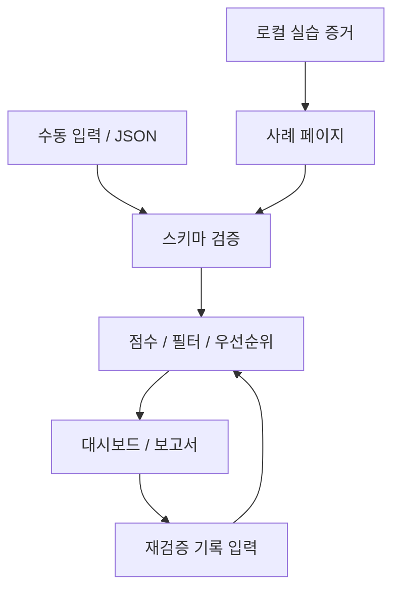

# 구조와 데이터 경계

## 웹앱

| 구성 요소 | 역할 | 주요 파일 |
|---|---|---|
| 입력 화면 | 수동 다중 입력, JSON 파일·텍스트 처리 | dist/index.html, dist/app.mjs |
| 분석 모델 | 스키마 검증, 점수, 필터, 정렬, 재검증 기록 | dist/model.mjs |
| 사례 페이지 | 실습 결과 표시, 확인 후 대시보드로 전달 | dist/portfolio.html, dist/portfolio.mjs |
| 임시 보관 | 페이지 메모리; 사례 전달은 sessionStorage | 브라우저 내부 |
| 선택적 보관 | 사용자가 선택한 경우 localStorage | 브라우저 내부 |
| 접근 제한 | 소유자만 허용하는 호스팅 정책 | Sites 설정 |

## 실습

Python 표준 라이브러리와 SQLite 메모리 DB만 사용합니다. WSGI 함수를 프로세스 안에서 호출하며 네트워크 서버를 시작하지 않습니다. 데이터는 고정된 합성 주문·상품입니다. 인증 주체는 테스트 어댑터가 주입합니다. 인증 시스템 자체는 평가 범위가 아닙니다.

취약 모드와 수정 모드에 동일한 요청을 적용해 응답과 정상 기능 유지 여부를 비교합니다. `lab/run_evidence.py`는 테스트 성공 후 응답, 실행 시각, 소스 SHA-256과 대시보드 입력 파일을 생성합니다.

## 보호 설계

- 사용자 문자열은 textContent 또는 HTML 이스케이프를 거쳐 표시합니다.
- 자료의 JSON은 실행하지 않고 파싱·검증합니다. 1MB와 200건 제한을 둡니다.
- 동적 외부 통신은 CSP의 `connect-src 'none'`으로 제한합니다.
- 수정 권고 링크는 코드에 정의된 OWASP 주소를 사용합니다.
- 서버 측 LLM 호출, 스캐너, 임의 URL 조회, 자격증명 저장 기능이 없습니다.
- 실습 소스는 내려받을 수 있지만 호스팅 환경에서 실행되지 않습니다.

입력 데이터의 비밀키·토큰·개인정보 제거는 사용자 책임입니다. 브라우저 저장소는 암호화 저장이나 다중 사용자 격리를 제공하는 서버 저장소를 대체하지 않습니다.
